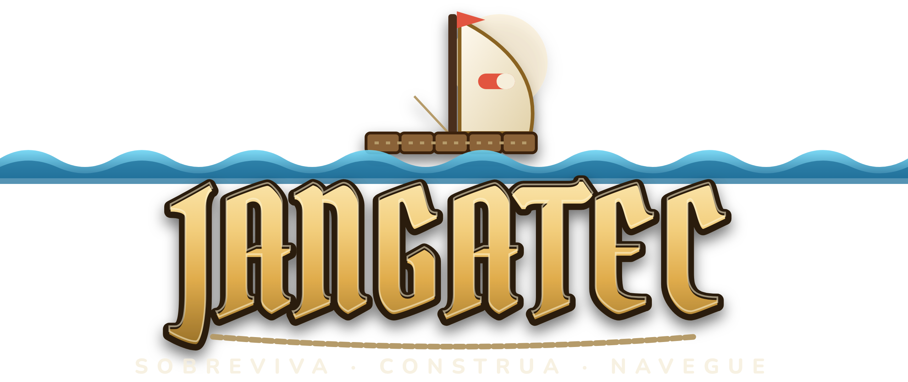

<p align="center"></p>

# Jangatec — protótipo

Jogo 3D de sobrevivência, exploração e construção em alto-mar, no navegador.
Three.js e Cannon-es no frontend, Node.js + WebSocket no backend.

## Rodar localmente

```bash
# 1) servidor multiplayer (opcional — o modo solo funciona sem ele)
cd server && npm install && npm start        # ws://localhost:3001

# 2) frontend
cd client && npm install && npm run dev       # http://localhost:8080
```

Abrir `index.html` direto do disco (file://) não funciona: módulos ES precisam de um servidor HTTP.

## Deploy

**Deploy completo no Render:** New > Blueprint > aponte para o repositório e use o `render.yaml`
da raiz. Ele cria o servidor WebSocket e o site estático; o cliente já recebe a URL do servidor
pela variável `VITE_SERVER_URL`. O servidor precisa acessar também `client/src/systems/loot.js`,
por isso o serviço backend usa a raiz do repositório como contexto de deploy.

O plano grátis do backend "dorme": a primeira conexão pode levar até ~1 minuto.

**Frontend na Vercel (alternativa):** New Project > mesmo repositório e mantenha Root Directory
na raiz (`.`). O `vercel.json` configura a instalação e publicação de `client/dist`. Se usar um
servidor Render com outro endereço, configure `VITE_SERVER_URL` como `wss://SUA-URL.onrender.com`.

## Controles

No celular/tablet os controles de toque aparecem sozinhos (`client/src/ui/touch.js`): joystick à
esquerda (empurre até o fim para correr), arraste a metade direita para girar a câmera, botões de
atacar/pegar, pular, interagir (E), mirar e recarregar, e no topo trocar arma, curar, câmera e tela cheia.
Durante a construção aparecem Soltar/Soldar/Mover/Cancelar e, no mastro, ◀ Vela ▶.

Teclas padrão abaixo — **todas podem ser trocadas** em Menu → Controles ou no painel de opções (⌨ Teclas),
com teclado ou mouse. A tabela de ações fica em `client/src/core/keybinds.js`: cada ação tem um contexto
(andando, construindo ou sempre) e nunca há tecla repetida no mesmo contexto (trocar para uma tecla em
uso troca as duas de lugar).

| Tecla | Ação |
|---|---|
| W A S D / Shift | andar / correr |
| Ctrl (segurar) | agachar (anda devagar; só levanta se houver espaço em cima) |
| Espaço | pular, subir em bordas, sair da água |
| Mouse ou setas | câmera |
| E | abrir caixa / instalar vela; controlar vela depois da partida |
| Z / C | soldar durante o build / girar vela perto do mastro |
| Botão esquerdo | pegar a peça contornada de verde |
| Q | soltar a peça carregada |
| Roda do mouse (construindo) | aproximar / afastar a peça carregada |
| Shift + roda · E (construindo) | girar a peça 15° no vertical (Shift+E ao contrário) |
| C (construindo) | inclinar a peça 15° (Shift+C ao contrário) |
| T (construindo) | endireitar (tira a inclinação, giro em múltiplos de 90°) |
| Mouse + WASD | virar câmera, arrastar a peça e andar |
| G (construindo) | teletransportar a peça para o ponto indicado pela mira |
| B (construindo) | build assistida: pontos de encaixe e alinhamento automático |
| R | liberar o cursor e abrir o gizmo de rotação |
| Shift durante o arraste | encaixar a rotação em incrementos |
| Botão direito no gizmo | mover a câmera sem sair da rotação |
| Botão direito fora do gizmo / Esc | cancelar e restaurar a peça |
| X | dessoldar peça fixada próxima |
| Clique / botão direito | atacar ou atirar / bloquear ou mirar fora do build mode |
| Segurar clique | carregar golpe pesado (depois do golpe leve) |
| Botão do meio | chute que quebra a guarda |
| Q | esquivar (fora do build) |
| V (segurar) | falar no chat de voz |
| G · F3 | opções gráficas · contador de FPS |
| 1 2 3 / roda do mouse | trocar entre armas do hotbar / inventário |
| 4 / 5 | usar bandagem / kit médico |
| F | alternar 1ª / 3ª pessoa (1ª é o padrão) |
| H | ajuda |

O contorno verde indica a peça visada que está ao alcance de coleta. Clique nela com o botão esquerdo
para pegar; pressione [Q] para soltar a peça no mundo.

Ao carregar, a peça real permanece visível e dinâmica: segue o raycast da mira por um controle de
mola, mantendo colisões com o cenário e com o personagem, gravidade e empuxo. Andar e girar a câmera
continuam disponíveis fora do modo de rotação. [R] libera o cursor e mostra o gizmo; arraste um anel
para girar a peça. Segure o botão direito para mover a câmera sem sair do modo de rotação e pressione
[R] novamente para voltar à mira. [Z] solda a peça somente quando ela estiver fisicamente encostada
na jangada, inclusive pela lateral; a posição do cursor não define o ponto de solda. Se a peça ficar presa,
pressione [G] para reposicioná-la no ponto indicado pela mira.

**Build assistida [B]** (`client/src/build/snap.js`): mostra bolinhas nos centros, meios das bordas e cantos
das peças da jangada (e no encaixe vazio do convés) e da peça carregada; a peça gira para alinhar com a
vizinha (múltiplos de 90°) e gruda no ponto mais próximo, em cima ou encostada do lado. A solda usa a
posição exata do encaixe.

**Combate corpo a corpo** (`client/src/systems/melee.js`): golpe leve sai no clique, cliques guardados
emendam o combo, segurar carrega o pesado, bloquear antes do impacto é finta, chute quebra a guarda,
golpes simultâneos fazem as espadas se chocarem (CLANG). Inimigos defendem, revidam e chutam quem só
bloqueia. Sons sintetizados em `client/src/core/sfx.js`. Inimigos usam linha de visão
(`Colliders.segmentBlocked`): não veem, atiram nem batem através de paredes e saem/entram pelas portas.

**Fortes de sucata** (`client/src/world/scrap.js`, `client/src/systems/siege.js`): em ilhas grandes, muro de
chapas onduladas enferrujadas com portão, contêiner e barraco com inimigos dentro e 1–2 torres de andaime
com um inimigo de **morteiro** (granadas em arco, anel vermelho de aviso, mira à frente da jangada). Bala de
canhão na torre tira vida (3 acertos): ela tomba, se desmancha e fica derrubada (mensagem `naval/tower`).
A **torreta-gancho** substitui o gancho de mão: instala no convés como o canhão e fisga caixotes, aliados e
inimigos.

**Acampamentos** (`client/src/world/camp.js`): cabana de tábuas (porta, janelas, telhado de palha em A,
varanda com barris) ou forte com paliçada pontuda, portão, torres de vigia e cabana no fundo.

Todos os jogadores começam em terra firme, com uma arma improvisada sorteada; ninguém nasce com
pistola. A jangada inicial tem uma plataforma central indestrutível e um encaixe para uma única
plataforma de madeira; ambas medem 6×6 m. Pegue a plataforma de madeira e fixe-a à jangada com `[Z]`; depois,
instale a vela no mastro com `[E]`.
O personagem do jogo é a **Pílula** (`client/src/player/pill.js`, modelo procedural), personalizada no
menu com prévia 3D (arraste para girar): cor da cápsula, da base e das luvas, 7 rostos, 5 calçados com
cor e 8 chapéus com cor; botão "Aleatório". A escolha fica salva no navegador e os outros jogadores a
veem no multiplayer. Em 1ª pessoa aparecem os bracinhos de tubo com as luvas de boxe da sua pílula.

Os **inimigos também são pílulas**, com visual malvado (`client/src/systems/evilpills.js`): olhos
vermelhos, sorriso serrilhado e acessórios por tipo — Saqueador (bandana, luvas com cravos), Atirador
(boné e revólver), Brutamontes (capacete com chifres), Corredor (olhos desencontrados) e Pirata
(tricórnio, tapa-olho e gancho).

Em 3ª pessoa, **[I] aproxima e [O] afasta** a câmera; mirar (botão direito) leva a câmera para
**sobre o ombro**, com retícula própria que abre com o recuo. A pílula aponta a arma para onde você
olha, dá tranco no disparo e mostra o clarão na boca do cano. Revólver, pistola, escopeta e rifle
têm **mira red dot** (o ponto fica no centro da tela ao mirar). As mãos em 1ª pessoa são luvas
arredondadas com dedos, na cor escolhida para a pílula. Opções gráficas: tecla **G**.

**Caído no multiplayer**: com aliados na sala, ao zerar a vida o jogador fica **caído** — não ataca
nem se cura, se arrasta devagar e sangra por 45 s (golpes encurtam o tempo). Um aliado reanima
**segurando E perto dele por 2,5 s** (volta com 35 de vida). Sem ajuda, ou se todos caírem, ele morre e
renasce no barco. Jogando solo, morrer continua levando direto ao barco.

**Corpo a corpo** (`client/src/systems/melee.js`, constantes em `MELEE`): com arma branca, clique =
golpe leve rápido (combo de 3 com animações variadas: corte, revés e um final aleatório — estocada,
uppercut ou giro de 360°), segurar o clique = golpe pesado carregado (pancada ou giro; quebra a
guarda e interrompe ataques), botão direito = bloquear (no instante do golpe vira **parry**: o inimigo
fica atordoado e o próximo golpe é crítico), **[Q] = esquiva** com invencibilidade. Golpes, bloqueios e
esquivas gastam **estamina** (barra dourada sob a vida); sem estamina a guarda quebra. A esquiva é
cambalhota (frente/trás) ou passo lateral, e o parry tem animação própria com faíscas. Os inimigos
avisam antes de bater (luva brilhando + "!" vermelho = leve, "!!" amarelo = pesado), têm golpes por
tipo (golpes variados, combos de 2–3, pancada em área), avançam no golpe, às vezes **desviam** ou
defendem, ficam atordoados com estrelas, rodeiam o
jogador e no máximo 2 atacam ao mesmo tempo. Impactos têm hit-stop, empurrão e números de dano.

As **armas** usam o mesmo modelo detalhado em 1ª e 3ª pessoa (`client/src/player/viewmodel-parts.js`):
madeira texturizada, cantos chanfrados, gatilho com guarda-mato e detalhes por arma (fita, pregos
tortos, estrias do tambor, trilho, cartuchos na coronha, bipé…).

O espaço de construção ao redor da jangada e da peça inicial fica livre; árvores, caixas e ruínas
ficam mais afastadas, na borda da ilha.

Após instalar a vela, há um breve período de calmaria, seguido por uma tempestade gradual e pela
subida global da água. As faixas mais baixas das ilhas são inundadas primeiro. Quando a terra
inicial estiver submersa, todos devem embarcar; a jangada então parte automaticamente para o oceano.
As ilhas exploráveis ficam acima da maré máxima e abrigam fortes improvisados ou cabanas com
guarnições de inimigos. Depois da partida, grupos de piratas podem alcançar a jangada em pequenas
balsas, lançar ganchos, voar até o convés e atacar quem estiver a bordo.

### Eventos do mar e balanceamento

Depois da partida o céu abre aos poucos. Os eventos são **raros e sem aviso** (primeiro entre 5 e 8 min,
depois 7–13 min entre eles, às vezes o mar só fica quieto), quase nunca repetem o mesmo tipo em seguida e
cada um sai diferente (força, velocidade, tamanho, lado e sentido de giro sorteados). O host sorteia
(`client/src/systems/events.js`, constantes em `EVENT_BALANCE`):

- **Onda gigante**: uma frente de água de 3,6–5,6 m atravessa o mar (entra em `waveHeight` e no shader,
  então barco, detritos e nadadores sentem a onda). Baixe a vela e fique perto do mastro; com a vela
  cheia a jangada é arremessada e quem está a bordo leva dano. Quem está longe do mastro é jogado
  pelo convés.
- **Furacão / redemoinho**: o mar se abre num **redemoinho gigante** (60–85 m de raio, funil d'água de
  7–11 m com garganta funda, braços de espuma girando) ao lado da rota. Ele gira a jangada junto com a
  água e vai puxando aos poucos (mais forte com o tempo e perto do centro). Levante a vela e gire-a para
  o lado oposto; se a jangada chegar ao centro, ela é sugada, gira e é cuspida com dano.

- **Menu e servidores** (`client/src/ui/mainmenu.js`): menu em abas (Jogar · Servidores · Personagem ·
  Opções · Controles) sobre a cena 3D. A aba Servidores lista as salas **ao vivo** (atualiza a cada 4 s,
  busca, jogadores, capitão, fase/distância), cria sala com **nome, senha opcional, limite de jogadores e
  seed**, e pede a senha ao entrar em sala trancada. No servidor: mensagens `list`/`rooms`, `join` com
  `create/password/max` (senha guardada como hash SHA-256) e `join-error`.
- **Chat de voz** (`client/src/net/voice.js`): WebRTC P2P entre os jogadores da sala (sinalização pela
  mensagem `rtc` do servidor, STUN público), voz **por proximidade em 3D** ou "rádio", aperte-para-falar
  (tecla configurável, padrão V) ou voz aberta com detecção de fala, volume/ganho e indicador de quem está falando no HUD.
  Sem servidor TURN: em algumas redes muito restritas a voz pode não conectar.
- **Desempenho**: malhas paradas de ilhas, fundo do mar, naufrágios e destroços são "assadas" numa malha por
  material (`client/src/core/bake.js`, ~63% menos draw calls); destroços a mais de 70 m dormem na física; o
  raycast de pegar peças só olha o que está ao alcance; no máximo 1 chunk novo por quadro; sombras a 30 Hz
  (Ultra: todo quadro). **Modos do FSR**: Nativo, Qualidade (67%), Equilibrado (59%), Desempenho (50%) e
  Ultra desempenho (33%); as predefinições usam Desempenho/Equilibrado/Qualidade/Nativo.
- **Pistola em 3D** (`client/public/models/pistola.glb`, carregada por `client/src/player/gunmodels.js`):
  modelo do Tripo reduzido de ~2 mi para ~17 mil triângulos, sem o pedaço solto, com o ferrolho separado
  (recua no tiro) e "pintado" por vértice (gunmetal, aço, polímero, painéis areia, quinas gastas e oclusão
  de ambiente). Scripts em `tools/` (`simplify-model.mjs`, `process-pistol.mjs`, rodam com Node +
  glTF-Transform). Enquanto o GLB carrega, a pistola procedural aparece no lugar.
- **Revólver em 3D** (`client/public/models/revolver.glb`): modelo do Tripo com texturas PBR (madeira entalhada,
  latão, metal oxidado), ~1,9 mi → ~30 mil triângulos, **tambor separado** detectado automaticamente
  (`tools/process-revolver.mjs`), que gira e abre para o lado na recarga, e red dot sobre a armação.
- **Mãos 3D em 1ª pessoa** (`client/public/models/mao.glb`): modelo do Tripo com textura PBR (pele, normal e
  metal/aspereza), reduzido de ~1,9 mi para ~15 mil triângulos e com **rig automático** (`tools/rig-hand.mjs`):
  detecta a mão direita, a orientação, os 4 dedos e o polegar, cria 15 ossos e os pesos de pele. Usa a mesma
  API das mãos procedurais (`setPose`), então as armas continuam fechando os dedos no cabo/gatilho. A mão
  esquerda é a direita espelhada. Até carregar, aparecem as luvas.
- **Personagem**: pílula mais baixa (1,45 m, cápsula mais curta) e **rosto animado** — pisca sozinho e a boca
  mexe com o volume da voz no chat (6 quadros prontos por estilo de rosto, só troca a textura).
- **Imersão** (menu Gráficos → Imersão, tudo opcional e salvo no navegador, fora das predefinições;
  `client/src/core/graphics.js`): tremor da câmera (0–100%, suave e com rotação), profundidade de campo
  (foco automático — no personagem em 3ª pessoa, no centro ao mirar/1ª pessoa), desfoque de movimento
  da rotação da câmera, balanço ao andar, água na lente (sair do mar, respingos, onda/redemoinho),
  efeito de vida baixa (dessatura + bordas vermelhas no ritmo do coração) e granulado + aberração
  cromática. A cena agora é renderizada com textura de profundidade para isso.
- **Ferramentas** (`client/src/systems/tools.js`, modelos em `viewmodel-parts.js`): **martelo** (caixa
  inicial) conserta a jangada; **gancho** (naufrágios/destroços) arremessado com física, puxa caixotes
  boiando e jogadores (mensagem `yank`); **banjo** com som sintetizado (Karplus–Strong), músicas de
  domínio público no clique e painel nota por nota ([B]); quem ouve por perto recupera vida (flag `mu` no
  estado do jogador, notas pela mensagem `music`). As armas **não quebram** mais.
- **Tempestade forte** (evento `tempestade`): céu escuro, raios frequentes e 5–8 ondas gigantes em série vindas
  de direções diferentes (geradas de uma seed: iguais para todos) que dão trancos na jangada e derrubam quem
  não está perto do mastro. No **furacão** quem está a bordo é empurrado para fora do redemoinho (`player.drift`);
  andar contra o empurrão firma o personagem, parado ele escorrega e cai.
- **Animações em 3ª pessoa** (`client/src/player/pill.js`): parado/andar/correr/de lado/de costas, postura com
  arma (pistola, arma longa, corpo a corpo, ferramenta), mira com base aberta, recarga por tipo (pente,
  escopeta, revólver), bandagem/kit, arremesso do gancho, banjo, martelo, escalar/pular obstáculo em etapas,
  pulo subindo/caindo, nado crawl e boiando, tranco ao levar dano e "amassada" ao aterrissar. A pose vai pela
  rede (`po`/`pp`/`ar`), então os aliados veem a mesma animação.
- **Batalha naval** (`client/src/systems/naval.js`, constantes em `NAVAL`/`PIECE_HP`; modelos em
  `client/src/world/navalmodels.js`): o **canhão improvisado** (galão d'água + cano) só sai em
  caixas/naufrágios a partir da região 3 (~640 m da rota); as balas são infinitas, com recarga longa (7 s). Instalado no convés, vira uma peça da jangada;
  sentado nele, a mira mostra a trajetória balística e uma retícula em círculo no ponto de impacto. As
  balas têm física (gravidade + velocidade da jangada) e são simuladas em todos os clientes; o host decide o
  dano. Com um canhão instalado, o host sorteia batalhas (raras): 1–2 **navios piratas grandes** emparelham
  e disparam bordadas; têm vida, pegam fogo, inclinam e **afundam**, soltando **caixotes de loot que boiam**. **Cada peça da jangada tem
  vida** (maior para peças grandes/de metal); destruída, solta-se. Só a plataforma do mastro é
  indestrutível. O **martelo** conserta peças (martelando, sem gastar material). Durante a batalha a maré é segurada no cheio (`Naval.holdK` em
  `tide.js`) e nenhum outro evento/invasão começa.

- **Oceano que seca** (`client/src/systems/tide.js`, constantes em `TIDE`): só dois estados — **mar cheio**
  e **mar seco** — num ciclo de 6 min (seco ≈ 2 min 24 s), com uma transição rápida (16 s) entre eles,
  calculado do relógio comum. Seco, a água desce abaixo do **fundo do mar** (`client/src/world/seabed.js`)
  e dá para andar livremente por ele. A jangada encalha até a água voltar. **Itens pesados afundam**
  (placa metálica, calha, sucata, pedaço de casa, tambor de metal e telha ondulada, `sinks: true` em `DEBRIS`): ficam no fundo e só são
  alcançáveis com o mar seco. **Naufrágios** (30% dos chunks sem ilha) têm 1–2 baús e destroços em volta.

Eventos são anunciados pela rede (`t: 'event'`) e derivados do relógio comum, então todos os
jogadores veem o mesmo. Piratas ficaram raros (`PIRATE_BALANCE` em `systems/enemies.js`): primeira
invasão após 2,5–3,5 min, depois a cada 3,5–5,5 min, com 1–3 balsas, nunca durante um evento.
As ilhas aparecem em 7% dos chunks (`islandChance` em `systems/loot.js`).

A ilha inicial é garantida e tem três caixas, incluindo um cache com pistola e bandagens
dimensionadas pela quantidade de jogadores. As caixas abrem com animação, mantêm o estoque e
permitem retirar cada item individualmente. No multiplayer, o servidor gera e controla o estoque
compartilhado; no modo solo, a geração usa a seed do mundo.

Armas usam raridade de 1 a 5 estrelas, atributos próprios de dano, alcance, cadência, precisão,
capacidade de carregador e durabilidade. Armas e raridades superiores dependem da exploração.
O loot é configurado em `client/src/systems/loot.js` por região, tipo de caixa, raridade,
quantidade e quantidade de jogadores para o cache inicial.

As ilhas aparecem com baixa frequência (7% dos chunks) para deixar mais espaço aberto no oceano;
a ilha inicial é a exceção garantida. Esta versão não possui crafting nem sede.

Detritos e peças colocadas são corpos rígidos com colisão; objetos flutuantes recebem empuxo
aproximado amostrado nas extremidades. Peças fixadas à jangada usam juntas rígidas ligadas ao corpo
cinemático da jangada. A água não é simulada como fluido.

## Gráficos

**Opções gráficas** (botão no menu, tecla `G` no jogo, ⚙ no celular; salvas no navegador) e
**contador de FPS** (`F3`). Predefinições Baixo / Médio / Alto / **Ultra**, ou ajuste fino:
escala de renderização (50–100%), upscaler, nitidez, sombras (até 4096 com borda suave e área maior),
MSAA 4x/8x, distância de visão (chunks carregados + neblina), qualidade da água (densidade da malha),
densidade de pixels, bloom e gradação de cor + vinheta.

**Benchmark** (botão no menu): percurso de câmera de ~55 s pelas cenas mais pesadas — oceano e ondas,
tempestade com chuva, onda gigante, furacão, explosões (`client/src/world/explosions.js`) e o mar
secando — e no fim um relatório com FPS médio, 1% mínimo, pior quadro, engasgos, nota e uma dica de
configuração (`client/src/systems/benchmark.js`).

Pipeline (`client/src/core/graphics.js`): a cena é desenhada em HDR na escala escolhida
(com MSAA e bloom opcionais) → **EASU-lite** (upscale bicúbico Catmull-Rom com anti-ringing,
inspirado no FSR 1 da AMD) + tone mapping Neutral + gradação, na resolução da tela → **RCAS**
(o afiador adaptativo do FSR 1). Com escala abaixo de 100% o jogo desenha menos pixels e ganha FPS;
o celular começa no Médio (75%).


Água em shader (ondas direcionais, Fresnel, reflexo do céu, espuma, água rasa perto das ilhas), céu em
gradiente que reage à tempestade, sombras do sol, IBL e tone mapping, palmeiras/rochas/grama procedurais e
textura de tábuas nas peças. Detalhes e convenções em `PROJECT_MAP.md` (seção 6b).

## Primeira pessoa

Em 1ª pessoa o jogador vê braços, mãos e arma (`player/viewmodel.js`, `viewmodel-parts.js`), desenhados
numa cena/câmera própria por cima do mundo. Nada disso é enviado pela rede: os outros jogadores só veem o
modelo de 3ª pessoa. As animações são procedurais (molas + keyframes): sacar, andar/correr, mira, recuo,
recarga por tipo de arma, golpes corpo a corpo, nado, escalada, carregar peça e usar bandagem/kit.
Para depurar poses no console: `G.viewmodel.debug = { reloadP: 0.4 }` (também `ads`, `sprint`, `swingP` +
`swingStyle`, `swim`, `carry`, `mantleU`).

## Estrutura

```
client/
  index.html, style.css
  vendor/            three.js (cópia local)
  package.json       Vite, Cannon-es e scripts de desenvolvimento/build
  src/
    main.js          cena, loop, menu e início da partida
    config.js        constantes e URL do servidor
    core/            input, utilidades, RNG com seed
    world/           oceano, Cannon-es, colisão, mundo procedural (chunks, detritos, ilhas)
    boat/            barco, flutuação, vela, catálogo de peças
    player/          personagem, parkour, câmera, modelo placeholder
    build/           construção modular
    systems/         início/inundação, vida/inventário, combate, inimigos, interação
    net/             cliente WebSocket
    ui/              HUD
server/
  server.js          salas, host, snapshots de barco/jogadores/física e estados das peças
```

Veja `PROJECT_MAP.md` (mapa rápido do código, ganchos e convenções) e `PROJECT_STATE.md` (estado atual e próximos passos).
